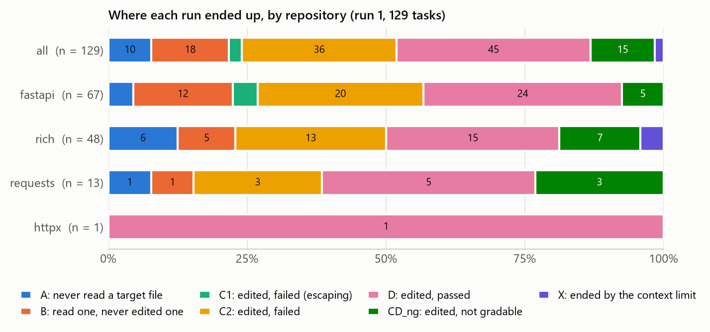

# navalign

[](https://github.com/vlyot/navalign/actions/workflows/tests.yml)

**PASS/FAIL tells you a coding agent failed. navalign tells you where.** It reads the agent's
trace and scores how fast it reached the code the real fix changed, so you can tell "never found
the bug" from "found it, fixed it wrong".



The competition's baseline agent on the 129 tasks of the Gemma 4 Developer Agent benchmark. How
soon it read a file the fix changed predicts whether it went on to edit one (AUC 0.75); none of
the navigation scores predicts whether the edit passed.

## Try it (1 minute, no data needed)

```
pip install git+https://github.com/vlyot/navalign
navalign score-trace --demo
```

```
toyshop_1: 9 tool calls; the exploration window is calls 1-6, before the first edit of a repo file

  first read of a fixed file   call 3     S_file 0.333
  reads that hit a fixed file  2 of 3     focus  0.667
  first read of fixed code     call 4
  mean distance of reads       1.00 hops  S_node 0.800  (cap 5 hops)
  first sight of the fix       call 1     (search results or reads)
```

The demo is a made-up shop whose discount codes charge the discount instead of taking it off; the
fix is in `apply_discount` in `toyshop/pricing.py`. The agent grepped for "discount" (call 1: the
fixed file shows up in the results), read the receipt code (2), the top of `pricing.py` (3) and
then `apply_discount` itself (4), before writing a repro script and editing the fix. Add `--steps`
for a row per call.

## Score your own agent

**Gemma 4 Developer Agent competitors:** build the ground truth for all 129 tasks from the
competition data (about 8 minutes on a Kaggle CPU), then point navalign at the folder your harness
run wrote its traces to:

```
navalign build --data /kaggle/input/competitions/gemma-4-developer-agent --out /tmp/groundtruth
navalign score --run results --groundtruth /tmp/groundtruth --out scores.csv
navalign score-trace results/traces/trace_fastapi_14303.json --groundtruth /tmp/groundtruth --steps
```

The ground truth is derived from the competition data, which may not be redistributed, so it is
not published; keep it out of a public notebook's output. Notebooks attached to the competition
have no Internet, so on Kaggle attach the `navalign-src` Dataset instead of installing; the
[quickstart notebook](https://www.kaggle.com/code/kaic87/navalign-quickstart) shows how.

## Use it on another benchmark

Per task, navalign needs the reference patch, the repository at the base commit, a call graph
(NetworkX node-link JSON) and the agent's ATIF trace. Lay them out like the
[toy example](src/navalign/examples/toy) and build the ground truth once:

```
navalign build --data mydata --out groundtruth
navalign score --run mytraces --groundtruth groundtruth --out scores.csv
```

No call graph? `navalign graph` builds one from the snapshots with Python's `ast`, in the same
format. SWE-agent trajectories convert straight into a run:

```
navalign graph --tasks mydata/tasks.jsonl --snapshots mydata/snapshots --out mydata/graphs
navalign swe-agent --trajs trajs --results results.json --out myrun
```

[docs/inputs.md](docs/inputs.md) has the formats, the graph's naming rules and which tool calls
count as reads; `notebooks/fetch_swebench.py` fetches 60 SWE-bench Verified tasks with SWE-agent's
trajectories as a worked example.

## What the scores mean

Every score covers the exploration window: the calls before the agent's first edit of a file in
the repository.

| Score | Meaning |
|---|---|
| S_file | 1/k, where k is the call that first read a file the fix changed (1 at call 1, 0 if never) |
| focus | share of the agent's reads that were in a fixed file |
| k_node | the call that first showed a fixed function or class |
| S_node | how close the reads were to the fixed code on the call graph: 1 − mean hops / cap |

Each run also gets an outcome: never read a fixed file, read one but never edited one, edited one
and failed (split by whether an escaping bug in the tools caused it), or passed. Full definitions:
[docs/methodology.md](docs/methodology.md).

## Commands

| Command | Does |
|---|---|
| `navalign score-trace` | navigation scores for one trace (try `--demo`) |
| `navalign score` | scores for every trace of a run, or of a folder of traces |
| `navalign build` | ground truth (targets, spans, distances) from tasks, graphs and snapshots |
| `navalign graph` | `ast` call graphs from snapshots, in the competition's graph format |
| `navalign swe-agent` | convert SWE-agent trajectories into a run |
| `navalign mapper` | map reference patches to target files and graph nodes |
| `navalign explore` | explored set and exploration window for every trace of a run |
| `navalign runs` | check and summarise a trace-collection run |
| `navalign escaping` | label every failed `edit_file` (escaping, stale, no_match) |
| `navalign grade` | summarise a gold-patch control or an agent regrade |
| `navalign validity` | oracle, random, issue-mention and BM25 baselines; hand-label sheets and agreement |
| `navalign analysis` | outcomes, result tables and figures for a scored run |
| `navalign compare` | compare two analysed runs of the same tasks |

`navalign <command> --help` lists a command's options; `python -m navalign` works too.

## Reproduce the results

The [quickstart notebook](https://www.kaggle.com/code/kaic87/navalign-quickstart) rebuilds the
ground truth from the competition data, checks it against the published tables, and redraws the
breakdown above and the paper's figures from the `navalign-results` Dataset on a Kaggle CPU.
[docs/reproduce.md](docs/reproduce.md) is the full pipeline, from the competition data (not in
this repository: the competition rules forbid redistributing it) to every table.

## Cite and licence

Citation details are in [CITATION.cff](CITATION.cff) (GitHub's "Cite this repository" button).
navalign is released under the [Apache 2.0 licence](LICENSE).
